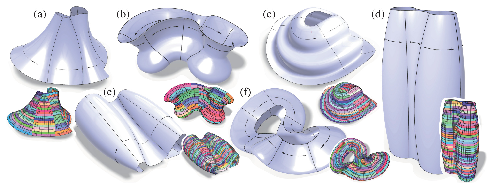
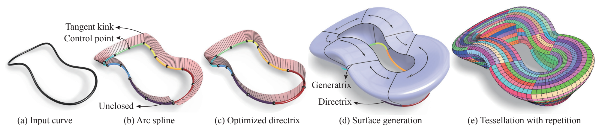

# Forward design of free-form surfaces composed of rotational patches

This Grasshopper definition takes two curves. The **directrix** sets the path through space, and the **generatrix** sets the cross-section. The definition fits a chain of circular arcs to the path, then sweeps the cross-section around each arc’s axis. Within a patch, the panels in each strip repeat by rotation. Changing the profile produces a new surface from the same fitted path.

Companion to the paper by **Yuanpeng Liu and Yi Min Xie**, *Automation in Construction*, 193 (2027), 107376. [PDF](forward%20design%20paper.pdf) · [View at publisher](https://doi.org/10.1016/j.autcon.2026.107376)

*Figure 13 from the paper. Each surface is shown with its tessellation.*

## Run the example

1. Download and extract the whole repository, or clone it. Keep the bundled `lib/` folder beside the definition. The example uses Rhino 8, Grasshopper, and the Kangaroo 2 components bundled with Rhino. [Setup guide](docs/installation.md)
2. Start Rhino 8, type `Grasshopper`, and open [arc_vFinal_Release.gh](arc_vFinal_Release.gh).

## How the definition works

*Figure 3 from the paper. Follow the same sequence from left to right on the Grasshopper canvas.*

| Canvas stage | What it does |
| --- | --- |
| **Directrix** | Rebuilds the rail as a cubic curve, centers its world-aligned bounding box at the origin and scales its longest side to `Size`. The later fit measurements refer to this prepared curve. |
| **Segmentation** | Samples the rail and greedily extends each arc as far as the fit tolerance allows. It outputs the segments and a list of shared endpoints and arc midpoints. The tolerance slider gives a fraction of the prepared rail length. Decrease it to fit finer detail. |
| **Optimization** | Refines the shared points to improve tangent alignment at the joints while controlling deviation from the rail. For a closed path it can also align the transported frame when it returns to the seam. The `oReport` panel gives the final RMS distance, RMS joint angle, closed-loop frame mismatch and optimizer time. |
| **Generatrix & Sweep** | Scales and places the profile in the first rail frame. Each circular segment revolves the profile about its axis. A straight segment translates it. The end section of one patch is the starting section of the next. |

## Shape and mesh controls

| Input on `GenerateSurface`| Effect |
| -- | --- |
| `Size` / `Scale` | `Size` is shared with the rail. The profile’s longest bounding-box side is `Size × Scale`, or 42 model units here. |
| `T` |  Chooses the attachment point by fraction of profile arc length. On a closed profile, zero is the seam. |
| `Ang` |  Rotates the profile about the initial rail tangent. |
| `OffX` / `OffY` |  Signed distances in the first rail’s normal plane. On an arc, positive X is radially outward and positive Y follows tangent × radial. With both at zero the attachment point touches the rail. |
| `EdgeLen` |  Nominal panel edge length in working model units. Smaller values give finer meshes. A nonpositive value returns the exact surfaces alone. |

A profile drawn anywhere in Rhino is centered and placed automatically. If a wide or offset profile folds back through a sweep axis, reduce `Scale` or adjust `OffX` and `OffY`. Figure 10 in the [paper](forward%20design%20paper.pdf#page=6) illustrates the geometric limit.

## Use the outputs

- **`Srf`** gives the exact Brep for each swept segment. Connect it to a Brep parameter to bake the surfaces into Rhino.
- **`PatchL`** gives one quad mesh per segment. **`LayersL`** gives one mesh strip per profile band, grouped by segment. Use these for panel studies or the downstream **supporting frame** preview.
- The **distinct shape / face number / ratio** panel displays the strip count, the reduction fraction, then the face count. Each strip counts as one panel family. In the saved example, 48 strips cover 288 faces, so the reduction is `1 − 48 / 288 = 0.8333`, or **83.3%**.

The [C# source files](src/) match the scripts embedded in the release, including the helpers used by the visualization clusters. To change the running definition, edit the corresponding script in Grasshopper and save the `.gh` file.

## Citation

Yuanpeng Liu and Yi Min Xie. “Forward design of free-form surfaces composed of rotational patches.” *Automation in Construction* 193 (2027), 107376. [DOI](https://doi.org/10.1016/j.autcon.2026.107376) · [Citation metadata](CITATION.cff)

## License

The authors’ Grasshopper definition and C# scripts are licensed under the **GNU General Public License, version 3 or later**. The paper and figures retain their publication terms. The bundled numerical libraries retain their own licenses. [Software license](LICENSE) · [Third-party notices and source](third-party/README.md)
